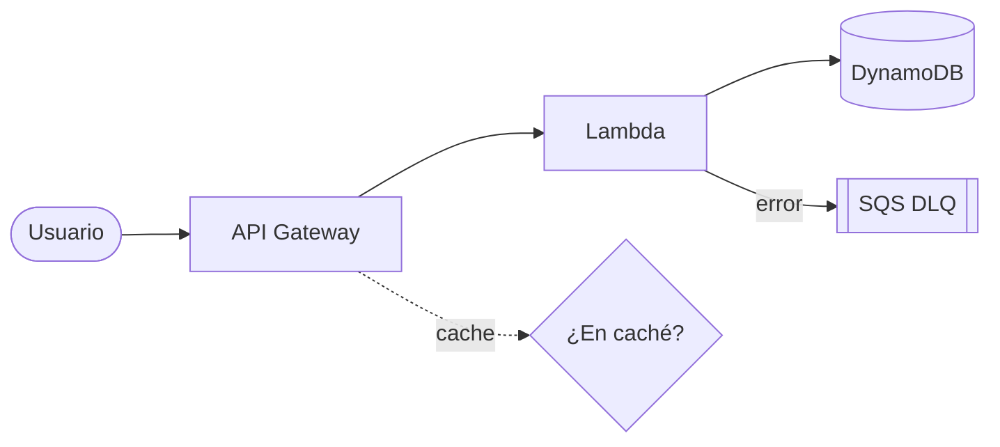
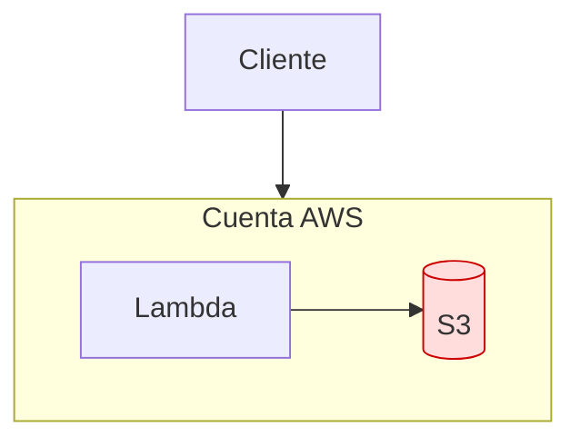
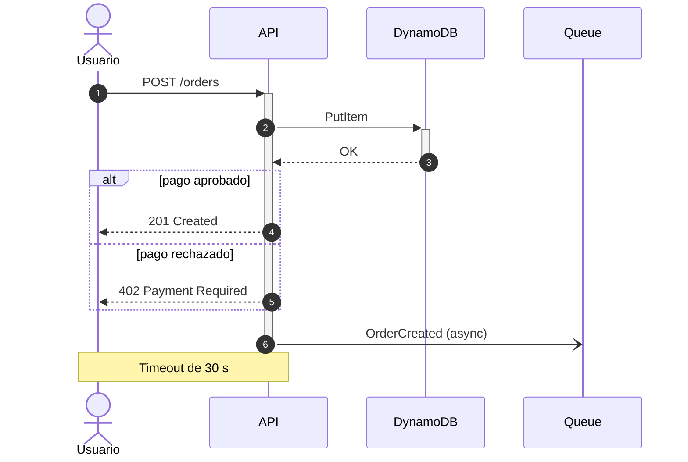
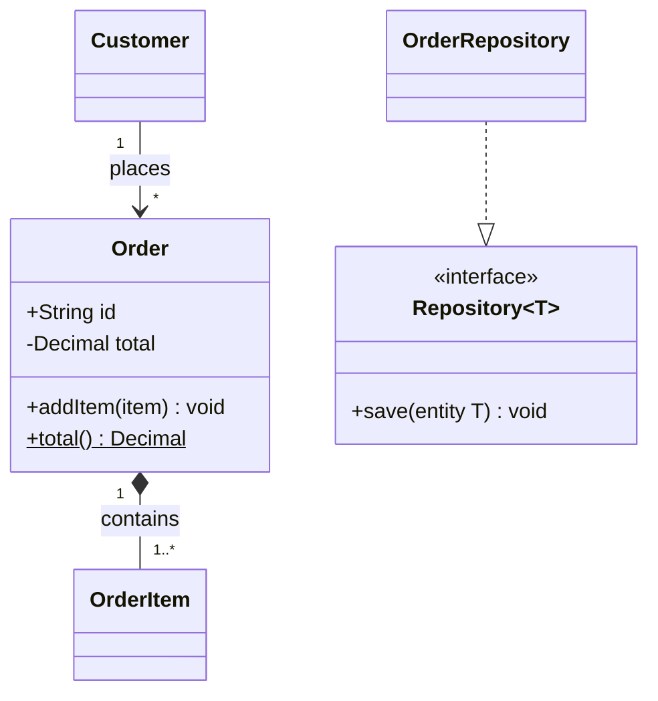
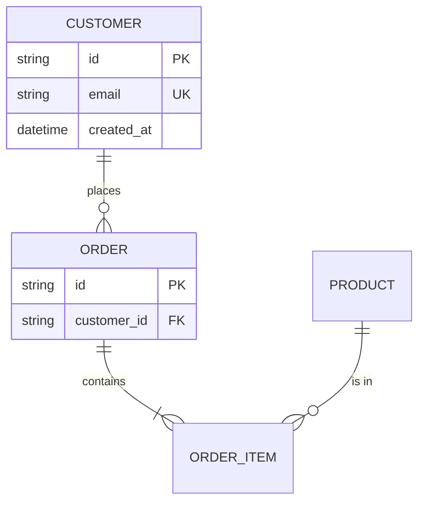
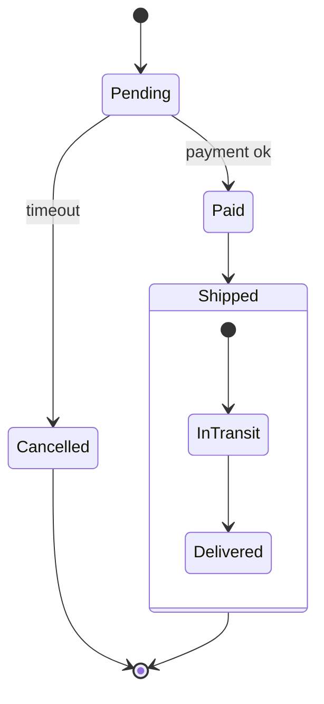
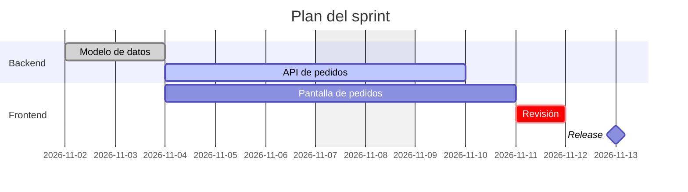
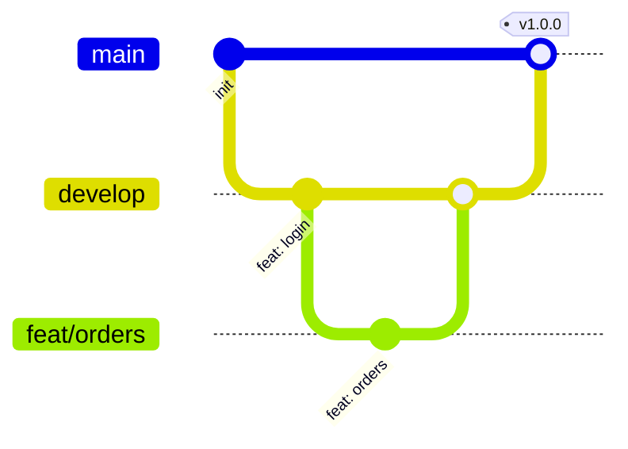
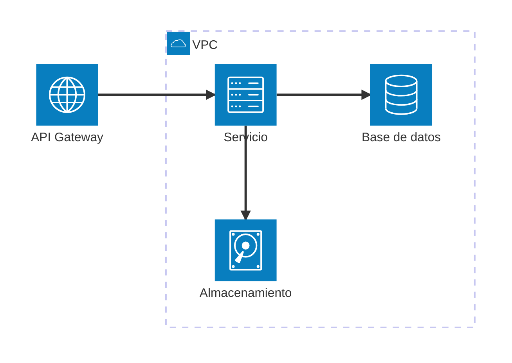
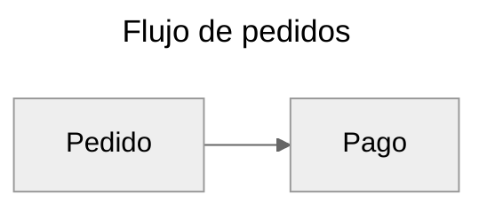

Mermaid dibuja diagramas a partir de texto dentro de un bloque ```` ```mermaid ````. GitHub y GitLab lo renderizan directamente, y es el formato obligatorio para los diagramas de `docs/` en el equipo.
Prueba tus diagramas en el editor en vivo de [mermaid.live](https://mermaid.live) antes de hacer commit.

## Flowchart: lo básico



| Sintaxis | Significado |
| --- | --- |
| `flowchart TD` | De arriba a abajo (igual que `TB`) |
| `flowchart LR` | De izquierda a derecha (también `RL` y `BT`) |
| `A --> B` | Flecha simple |
| `A --- B` | Línea sin flecha |
| `A -.-> B` | Flecha punteada |
| `A ==> B` | Flecha gruesa |
| `A -->\|texto\| B` | Flecha con etiqueta (también `A -- texto --> B`) |
| `A --o B` / `A --x B` / `A <--> B` | Punta de círculo, de cruz o bidireccional |
| `A & B --> C` | Varios nodos a la vez |

## Flowchart: formas y estilos

| Sintaxis | Forma |
| --- | --- |
| `id[Texto]` | Rectángulo |
| `id(Texto)` | Rectángulo redondeado |
| `id([Texto])` | Estadio (inicio o fin) |
| `id[[Texto]]` | Subrutina |
| `id[(Texto)]` | Cilindro (base de datos) |
| `id((Texto))` | Círculo |
| `id{Texto}` | Rombo (decisión) |
| `id{{Texto}}` | Hexágono |
| `id[/Texto/]` | Paralelogramo (entrada o salida) |
| `id@{ shape: cyl, label: "DB" }` | Sintaxis extendida de formas (v11.3+) |



Usa `subgraph id [Título] ... end` para agrupar, `classDef` + `class` (o `nodo:::clase`) para estilos y comillas (`id["Texto (con) símbolos"]`) si la etiqueta lleva caracteres especiales.

## Diagrama de secuencia



| Sintaxis | Significado |
| --- | --- |
| `participant A as Alias` / `actor A` | Declara un participante (caja) o actor (figura) |
| `A->>B: msg` | Mensaje síncrono (línea continua) |
| `A-->>B: msg` | Respuesta (línea punteada) |
| `A-)B: msg` | Mensaje asíncrono (punta abierta) |
| `A-xB: msg` | Mensaje fallido (punta de cruz) |
| `A->>+B` / `B-->>-A` | Activa / desactiva la barra de ejecución de `B` |
| `alt ... else ... end` | Caminos alternativos (también `opt` y `par ... and ... end`) |
| `loop Cada 5 min ... end` | Bucle |
| `Note right of A: texto` | Nota (también `left of` y `over A,B`) |
| `autonumber` | Numera los mensajes automáticamente |

## Diagrama de clases



| Sintaxis | Significado |
| --- | --- |
| `+` / `-` / `#` / `~` | Visibilidad: público, privado, protegido, de paquete |
| `método()$` / `método()*` | Estático / abstracto |
| `<<interface>>` | Estereotipo |
| `A <\|-- B` | Herencia: `B` hereda de `A` |
| `A *-- B` | Composición |
| `A o-- B` | Agregación |
| `A --> B` | Asociación |
| `A ..> B` | Dependencia |
| `A ..\|> B` | Realización: `A` implementa `B` |

## Diagrama entidad-relación



| Sintaxis | Cardinalidad |
| --- | --- |
| `\|\|` | Exactamente uno |
| `o\|` | Cero o uno |
| `}o` / `o{` | Cero o muchos |
| `}\|` / `\|{` | Uno o muchos |
| `--` | Relación identificadora (línea continua) |
| `..` | Relación no identificadora (línea punteada) |
| `PK`, `FK`, `UK` | Claves primaria, foránea y única en los atributos |

## Diagrama de estados



| Sintaxis | Significado |
| --- | --- |
| `[*]` | Estado inicial o final |
| `A --> B: evento` | Transición con etiqueta |
| `state A { ... }` | Estado compuesto |
| `state check <<choice>>` | Nodo de decisión |
| `state f <<fork>>` / `<<join>>` | Bifurcación y unión de flujos paralelos |
| `note right of A: texto` | Nota |

## Gantt



| Sintaxis | Significado |
| --- | --- |
| `dateFormat YYYY-MM-DD` | Formato de las fechas de entrada |
| `section Nombre` | Agrupa tareas |
| `Tarea :id, 2026-11-02, 3d` | Tarea con id, inicio y duración |
| `after id` | Empieza cuando termina otra tarea |
| `done`, `active`, `crit` | Estados: hecha, en curso, crítica |
| `milestone` | Hito (duración `0d`) |
| `excludes weekends` | No cuenta fines de semana |

## gitGraph



| Sintaxis | Significado |
| --- | --- |
| `commit id: "msg"` | Commit con etiqueta (también `tag: "v1"` y `type: HIGHLIGHT`) |
| `branch nombre` | Crea una rama y se cambia a ella |
| `checkout nombre` | Cambia de rama |
| `merge nombre` | Fusiona la rama en la actual |
| `cherry-pick id: "msg"` | Copia un commit por su id |

## Arquitectura (architecture-beta)

Tipo de diagrama en beta para servicios cloud: la sintaxis aún puede cambiar.



| Sintaxis | Significado |
| --- | --- |
| `group id(icono)[Título]` | Contenedor; admite `in padre` para anidar |
| `service id(icono)[Título] in grupo` | Servicio dentro de un grupo |
| `junction id` | Punto de unión para repartir conexiones |
| `a:R --> L:b` | Conecta el lado derecho de `a` con el izquierdo de `b` |
| `L`, `R`, `T`, `B` | Lados: izquierda, derecha, arriba, abajo |
| `cloud`, `database`, `disk`, `internet`, `server` | Iconos incluidos por defecto |

Iconos como `logos:aws-lambda` requieren registrar un icon pack de Iconify, y GitHub y GitLab no lo hacen: en repos usa los iconos por defecto.

## Configuración y buenas prácticas



| Elemento | Uso |
| --- | --- |
| Frontmatter `config:` | Tema (`default`, `neutral`, `dark`, `forest`, `base`) y opciones por diagrama |
| `%% texto` | Comentario que no se dibuja |
| `"texto"` en etiquetas | Permite paréntesis, `:` y otros símbolos |
| `<br>` en etiquetas | Salto de línea dentro de un nodo |
| `click id "https://..."` | Enlace en un nodo (no todos los visores lo permiten) |

Mantén un diagrama por idea, con menos de 15 nodos; si crece, divídelo en varios y enlázalos desde el texto.
